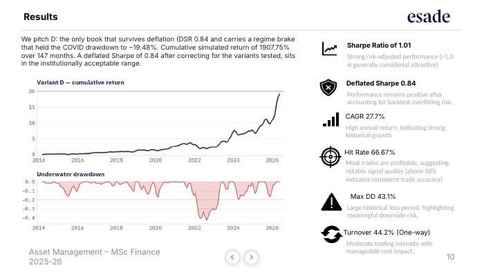

# Substrate Capital — Systematic 130/30 Long-Short Equity

**ESADE MSc Finance · Asset Management (Dr. Miquel Noguer i Alonso) · June 2026**
**Team:** Amir Alexander Csüri (strategy and ML pipeline) · **Mia Becker-Cooper (risk framework and methodology)** · Gavin Campbell (backtest validation and results) · Marco Vujosevic (fund structure and capacity)

## The idea
AI capex is the largest investment cycle in modern markets, and it flows into a definable set of 58 listed companies across three layers: hyperscalers that spend, semiconductor names that turn spend into compute, and power names that supply the electricity. We don't bet on whether AI succeeds. We rank the names against each other every month and trade the spread.

## How it works
- **Signal:** a random forest predicts whether each stock beats the cross-sectional median next month, using 15 features (9 technical, 6 macro). Price momentum leads. Fundamentals were excluded to avoid look-ahead bias.
- **Portfolio:** long the top quintile, short the bottom quintile, sized 130/30 because the model ranks winners more reliably than losers. Probabilities are smoothed over 3 months to cut turnover.
- **Regime overlay:** a 2-state Gaussian HMM on VIX and the US yield-curve slope, fitted only on pre-test data, cuts gross exposure to 50% in stress.
- **Validation:** walk-forward refits every 12 months with a 2-month embargo, 15 bps per side costs, four structural variants reported, deflated Sharpe to correct for multiple testing, and a survivorship test on the 37 names listed before 2012.

## Results (simulated, 147 months)
| Metric | Variant D: 130/30 + HMM overlay |
|---|---|
| CAGR | 27.7% |
| Sharpe ratio | 1.01 |
| Deflated Sharpe | 0.84 |
| Max drawdown | −43.1% (COVID drawdown held to −19.5%) |
| Annualized alpha vs factors | 5.2% (t = 0.67, not yet significant) |
| Survivorship test (pre-2012 names) | Sharpe 1.00, deflated Sharpe 0.84 |

We report honestly that most of the return is deliberate sector beta (SOXX beta 0.73). The market-neutral variants post a Sharpe of 0.22, so the selection alpha is positive but not yet statistically significant.

## My contribution
I owned the risk framework and the methodology: stress testing, risk controls, and the backtest design choices behind the walk-forward, embargo and deflated-Sharpe reporting. I also built the methodology, results, capacity, disclosures and closing slides.

## Files
- [Substrate_Capital_Pitch.pdf](Substrate_Capital_Pitch.pdf): the 15-slide fund pitch
- Code: [substrate-capital-backtest](https://github.com/miabeckercooper/substrate-capital-backtest)
