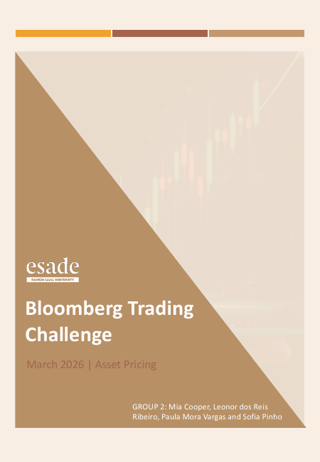

# Bloomberg Trading Challenge — Multi-Asset Portfolio Under Stress

**ESADE MSc Finance · Asset Pricing · 6–20 March 2026 (10 trading days)**
**Team (Group 2):** Mia Becker-Cooper · Leonor dos Reis Ribeiro · Paula Mora Vargas · Sofia Pinho

## Brief
Manage a €100M portfolio on Bloomberg through a volatile window: VIX above 20, oil heading towards $112 on geopolitical conflict, and unclear monetary policy.

## Approach
We built for resilience rather than maximum return: core equities, a VIX-futures volatility overlay, European defence and energy themes, inflation hedges, merger arbitrage, and a deliberate 54.3% cash buffer.

## Results
| Metric | Value |
|---|---|
| Total return | +0.70% vs −2.4% for the B500 benchmark (+3.1 pp) |
| Return on invested capital (€46M) | +1.54% |
| Sharpe / Sortino | 1.61 / 3.00 |
| Annualized volatility | 10.6% |
| Max drawdown | below 1% |

## What we learned
Macro and thematic positioning, not stock picking, drove returns over such a short window. The hedges did their job (VIX ETF +7.4%), but the large cash buffer cost an estimated €2.4M against full deployment, and the best hedges were sized too small to matter.

## Files
- [Bloomberg_Trading_Challenge_Report.pdf](Bloomberg_Trading_Challenge_Report.pdf): full trading report with attribution and post-mortem
