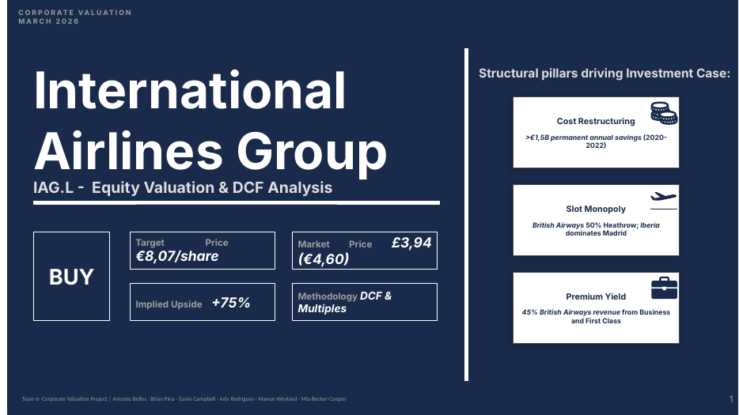

# International Airlines Group (IAG.L) — Equity Valuation

**ESADE MSc Finance · Corporate Valuation · March 2026**
**Team 6:** Antonio Belles · Brian Pina · Gavin Campbell · Inês Rodrigues · Manon Weyland · Mia Becker-Cooper

## Recommendation: BUY
Target price **€8.07** vs a market price of €4.60 (£3.94), an implied upside of **+75%**.

## Thesis
1. **Restructuring:** more than €1.5B of annual costs permanently removed in 2020–22.
2. **Slot position:** British Airways holds about 50% of Heathrow slots, and Iberia dominates Madrid.
3. **Premium yield:** about 45% of BA revenue comes from Business and First class.

## Valuation
- **DCF:** 10-year forecast, revenue growth fading from 4% to 2%, NOPAT margin settling at 10% in perpetuity. WACC 7.2% (CAPM with a Spain country-risk premium; IAG beta 1.30 checked against a Hamada-relevered peer beta). Intrinsic value €10.08/share, with terminal value at 61% of EV.
- **Multiples:** cross-check against European legacy and low-cost carriers.
- **Blended target:** €8.07, deliberately below the DCF value.
- **Sensitivity:** WACC × terminal growth grid.

## Files
- [IAG_Valuation_Report.pdf](IAG_Valuation_Report.pdf): written valuation report
- [IAG_Valuation_Presentation.pdf](IAG_Valuation_Presentation.pdf): pitch deck
