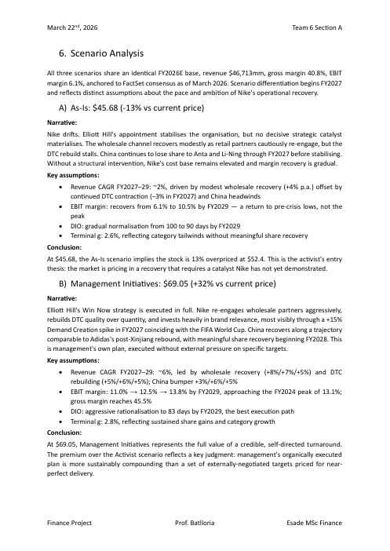

# Nike — Activist Investor Simulation and Valuation

**ESADE MSc Finance · Finance Project (Prof. Batlloria) · March 2026**
**Team 6, Section A:** Antonio Belles · Brian Pina · Gavin Campbell · Inês Correia Rodrigues · Manon Weyland · Mia Becker-Cooper
**Role in the simulation:** Nike management, negotiating against an activist hedge fund

## The case
A role-play over several weeks. The activist side attacked Nike's falling EBITDA, margin compression and weakness in China. We defended management's "Win Now" turnaround, wrote the management response letter, negotiated targets, and presented the valuation in a live Q&A.

## Valuation (current price $52.40)
| Scenario | Value per share | vs price |
|---|---|---|
| As-is (no catalyst) | $45.68 | −13% |
| Management initiatives | $69.05 | +32% |
| Activist consensus | $67.31 | +28% |

- DCF as the primary method (WACC 8.43%), with peer multiples as a cross-check (Adidas, Lululemon, On; Apple and Starbucks as brand-premium peers).
- WACC × terminal-growth sensitivity, plus a Monte Carlo simulation on the management case.
- **Key argument:** a self-directed turnaround is worth slightly more than externally imposed targets. The as-is DCF and the bear-case EV/EBITDA meet independently at $45–46.

## Files
- [Nike_Valuation_Report.pdf](Nike_Valuation_Report.pdf): valuation report with scenario analysis
- [Nike_Management_Letter.pdf](Nike_Management_Letter.pdf): management's response to the activist
