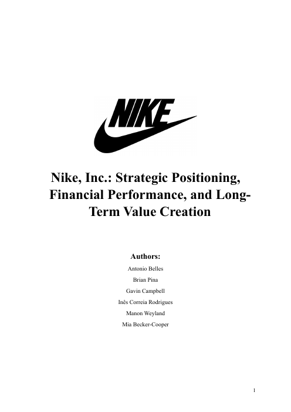

# Nike — Strategic Positioning and Financial Performance

**ESADE MSc Finance · Finance Project · 2026**
**Team 6:** Antonio Belles · Brian Pina · Gavin Campbell · Inês Correia Rodrigues · Manon Weyland · Mia Becker-Cooper

## What it covers
1. **Industry dynamics:** the global sportswear market, competitive forces, and new entrants such as On and Hoka.
2. **Company analysis:** Nike's shift to direct-to-consumer and back, and the new CEO's "Win Now" strategy.
3. **Financial analysis:** restated financial statements, ROIC and operating-spread analysis, a DuPont breakdown of ROE, and leverage and capital returns compared with peers.

## Selected findings
- ROIC fell to 21.1% in 2024: an efficiency trap from the DTC push.
- ROE fell from 39.5% (2023) to 24.4% (2024). The DuPont breakdown shows margin, not leverage, drove the drop.
- Debt-funded buybacks shrank the equity base, which flatters ROE and calls for caution in reading it.

## Files
- [Nike_Strategic_and_Financial_Analysis.pdf](Nike_Strategic_and_Financial_Analysis.pdf): full report with appendices
