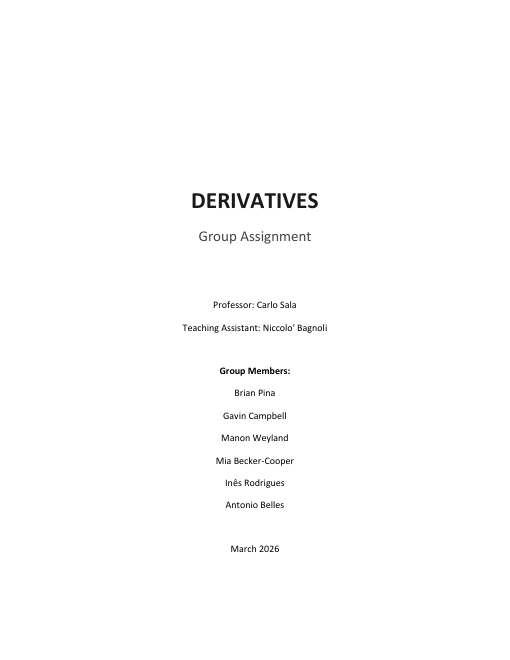

# Derivatives — Pricing, Simulation and Hedging

**ESADE MSc Finance · Derivatives (Prof. Carlo Sala) · March 2026**
**Team:** Brian Pina · Gavin Campbell · Manon Weyland · Mia Becker-Cooper · Inês Rodrigues · Antonio Belles

## Ten problems, built in Excel
1. Monte Carlo simulation of a stock under geometric Brownian motion (100,000 paths, quarterly vs direct discretization)
2. Implied volatility and put pricing
3. Valuing an executive compensation contract
4. S&P 500 historical volatility and Black-Scholes pricing
5. No-arbitrage bounds
6. Option trading strategies
7. Forwards vs futures for hedging FX risk
8. One-step binomial tree pricing
9. Delta hedging a short call
10. From binomial trees to Black-Scholes (convergence)

## Files
- [Derivatives_Group_Assignment.pdf](Derivatives_Group_Assignment.pdf): full write-up with results and discussion
