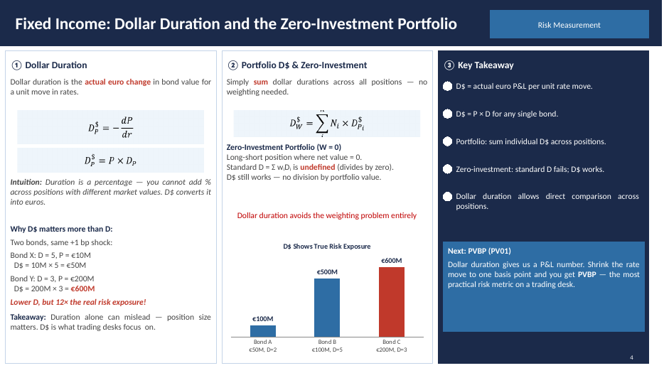

# Fixed Income — Duration, Convexity and Immunization

**ESADE MSc Finance · Fixed Income · 2026**
**Group 6:** Inês Correia Rodrigues · Gavin Campbell · Brian Pina · Antonio Belles · Mia Becker-Cooper · Manon Weyland

A class lecture-review presentation on how fixed-income desks measure and manage interest-rate risk:

1. Duration: Macaulay and modified, with intuition
2. Dollar duration and why it still works for zero-investment portfolios
3. Price value of a basis point (PVBP / DV01)
4. Convexity
5. Immunization
6. In practice: the butterfly strategy

## Files
- [Fixed_Income_Duration_Convexity.pdf](Fixed_Income_Duration_Convexity.pdf)
