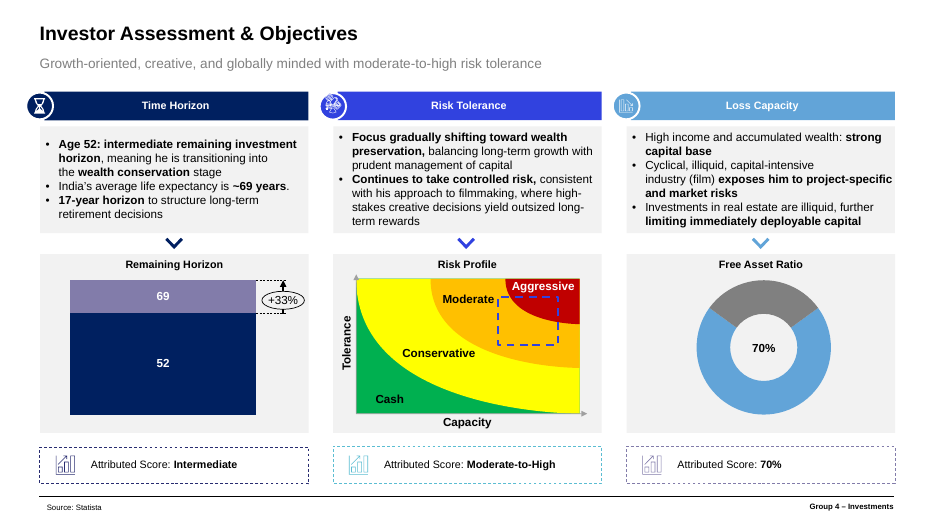

# Private Client Portfolio — Multi-Asset ETF Strategy

**ESADE MSc Finance · Investments · November 2025**
**Group 4:** Henry Dixon · Mia Becker-Cooper · Clemens Bene · Alejandro Font-Beltran · Tomiris Kabidullina · Malak Fanous

## Brief
Build a portfolio for an ultra-high-net-worth client: a 52-year-old Indian film director with moderate-to-high risk tolerance, a 17-year horizon, illiquid real-estate holdings, ESG preferences, and exposure to rupee depreciation.

## Approach
- Investor profiling: risk tolerance, loss capacity, horizon and free-asset ratio
- Macro view: India's growth versus currency and geopolitical risk
- A four-step diversification by asset class, geography, sector and instrument
- ETF selection and weighting, with rebalancing and hedging assumptions

## Result vs a custom benchmark
| Metric | Portfolio | Benchmark |
|---|---|---|
| Expected return | 10.0% | 8.5% |
| Sharpe ratio | 1.12 | 0.84 |

## Files
- [Private_Client_Portfolio.pdf](Private_Client_Portfolio.pdf): presentation with appendix
