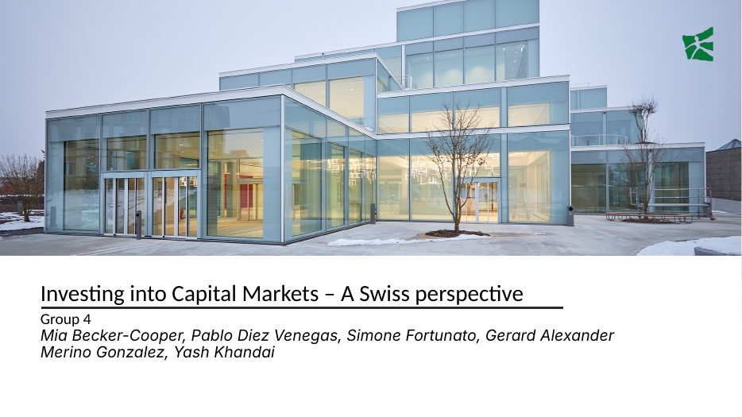

# Investing into Capital Markets — A Swiss Single-Family Office

**ESADE MSc Finance · Study Tour · January 2026**
**Group 4:** Mia Becker-Cooper · Pablo Diez Venegas · Simone Fortunato · Gerard Alexander Merino Gonzalez · Yash Khandai

## Brief
A Swiss entrepreneur sells his industrial automation company to private equity for CHF 500M, most of his wealth. He sets up a single-family office for long-term preservation and transfer to the next generation, and needs CHF 5M of liquidity a year.

## Our recommendation
- Long-term, moderate-risk allocation across private equity, public equities, real estate, fixed income, hedge funds and cash
- About 60% in illiquid assets to capture an illiquidity premium, with hedge funds for tail-risk protection
- Target return of 10.4% a year, with a phased 12-month deployment and stress-tested liquidity

## Files
- Swiss_Family_Office_Portfolio.pdf (to add)
