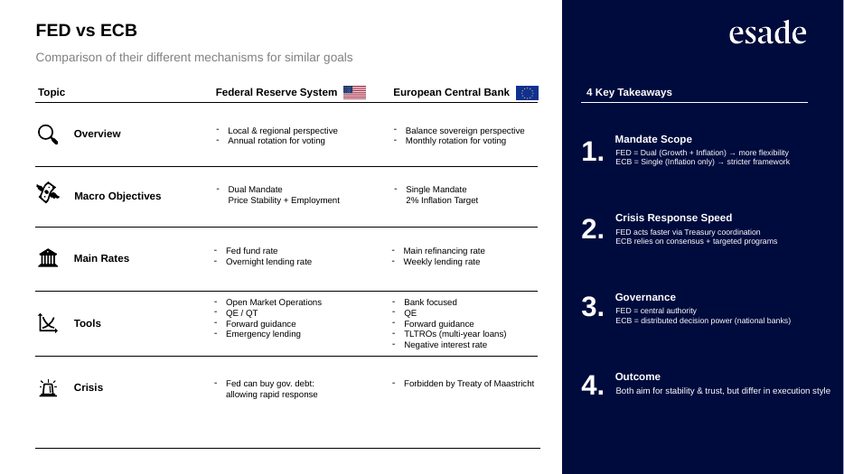

# Central Banks — Fed vs ECB

**ESADE MSc Finance · Investments · November 2025**
**Group 4:** Henry Dixon · Mia Becker-Cooper · Clemens Bene · Alejandro Font-Beltran · Tomiris Kabidullina · Malak Fanous

- Central bank objectives and tools
- How the Fed and ECB differ: mandate, governance, crisis tools
- Policy stances as of October 2025 and the divergence between them
- What divergence means for yields, EUR/USD and investor flight to safety
- Case study: how Peru's central bank kept stability through political instability

## Files
- [Central_Banks_Fed_vs_ECB.pdf](Central_Banks_Fed_vs_ECB.pdf)
