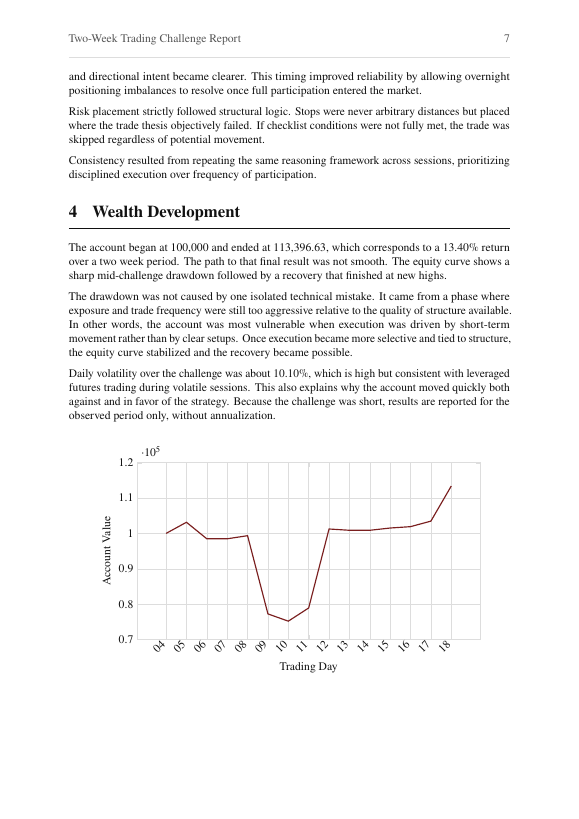

# Two-Week Trading Challenge: Index Futures, Metals and FX

**ESADE MSc Finance · Derivatives (Prof. Carlo Sala) · February 2026**
**Team (Group 6, Section A):** Brian Pina · Inês Correia Rodrigues · Mia Becker-Cooper · Gavin Campbell · Manon Weyland · Antonio Belles
**Result:** 4th place

## Brief
Trade a 100,000 account for two weeks, then explain the strategy, the economics behind it, the risk framework and how wealth developed.

## Strategy
- **Markets:** E-mini and Micro E-mini S&P 500 and Nasdaq-100 futures, gold and silver futures, and a few FX swing trades (EUR/USD, USD/JPY).
- **When:** mostly intraday, in the New York morning session, when volume and direction are clearest.
- **Two setups:** EMA pullback continuation in trends, and failed-breakout reversals in ranges, where late entrants get trapped.
- **Risk:** fixed-fraction sizing, trades planned in R-multiples with at least 2:1 reward-to-risk, and stops at the point where the trade idea is proven wrong.

## Results
| Metric | Value |
|---|---|
| Start → end equity | 100,000 → 113,396.63 |
| Two-week return | +13.40% |
| Max drawdown | −27.10% |

## What we learned
The drawdown came early, before hard stops were enforced. After it we tightened risk per trade, raised selectivity and traded less often, and the equity curve recovered steadily to a new high. The lesson we took: a strategy only gets to show its edge if it survives, so cutting the left tail matters more than chasing upside.

## Files
- [Two_Week_Trading_Challenge_Report.pdf](Two_Week_Trading_Challenge_Report.pdf): full report with trade examples and the equity curve
